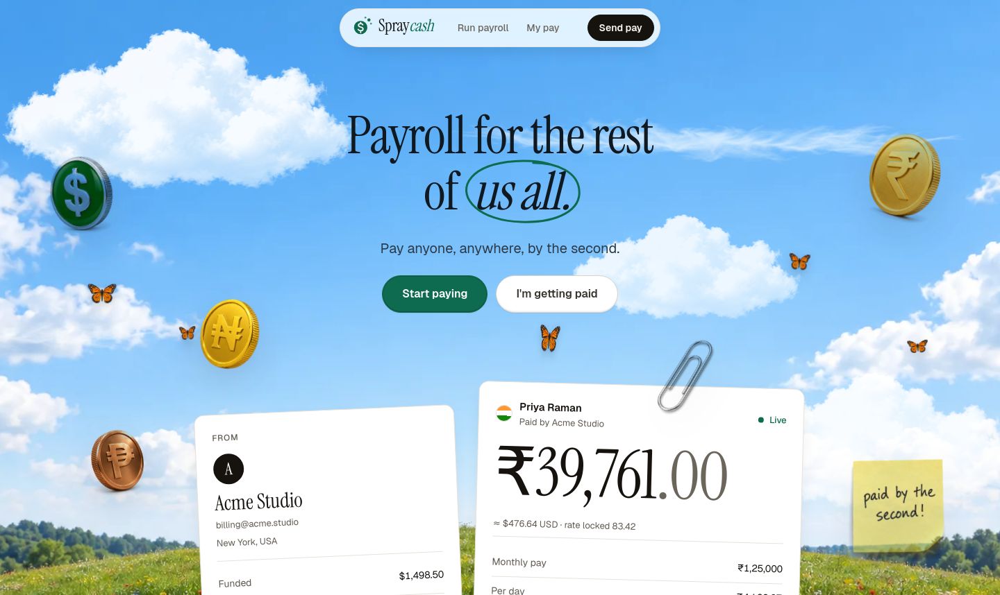
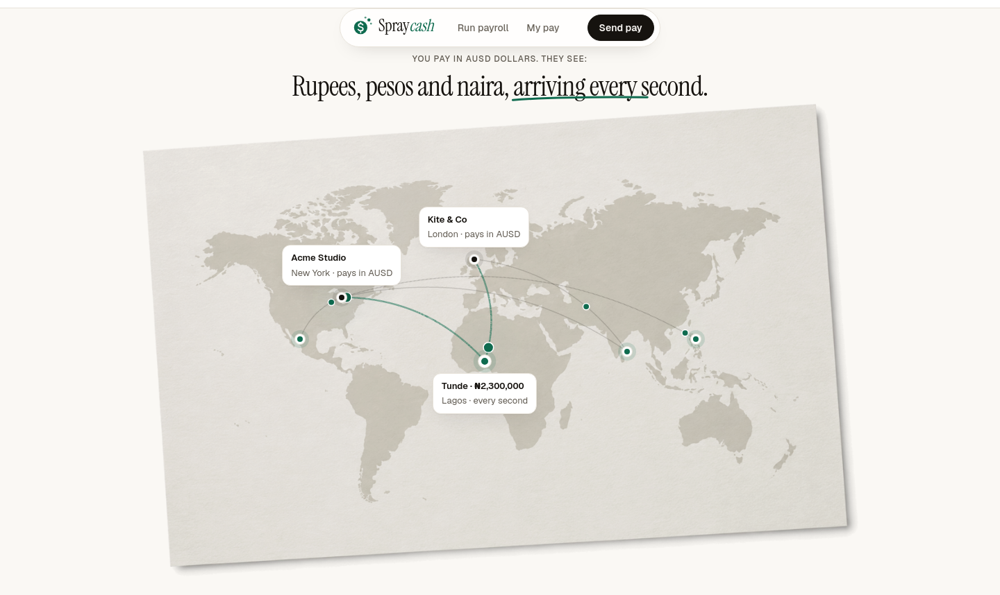
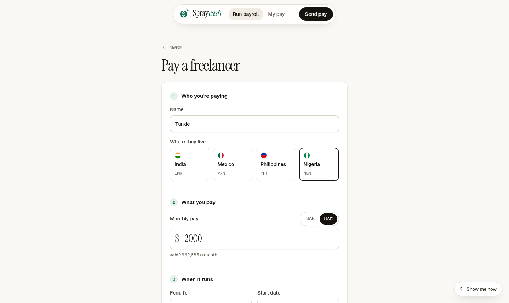
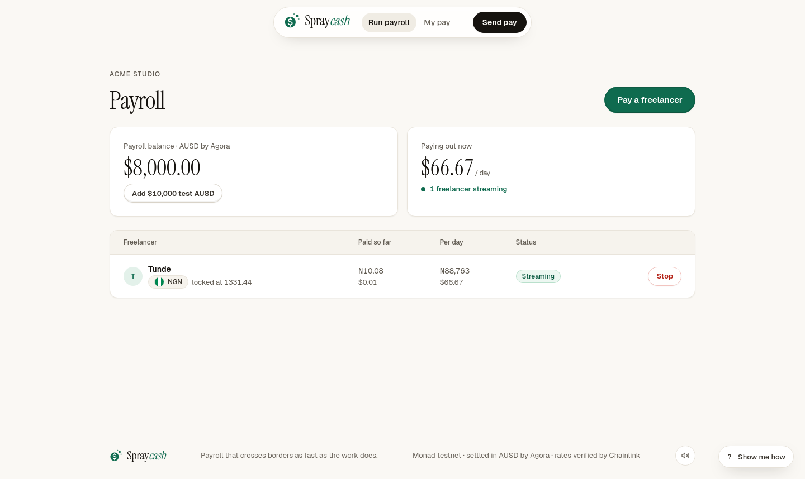
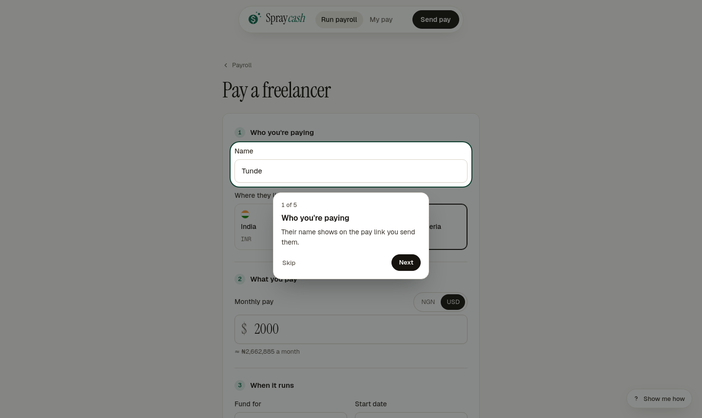
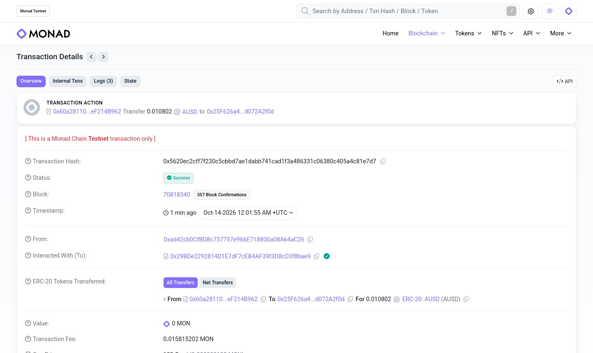
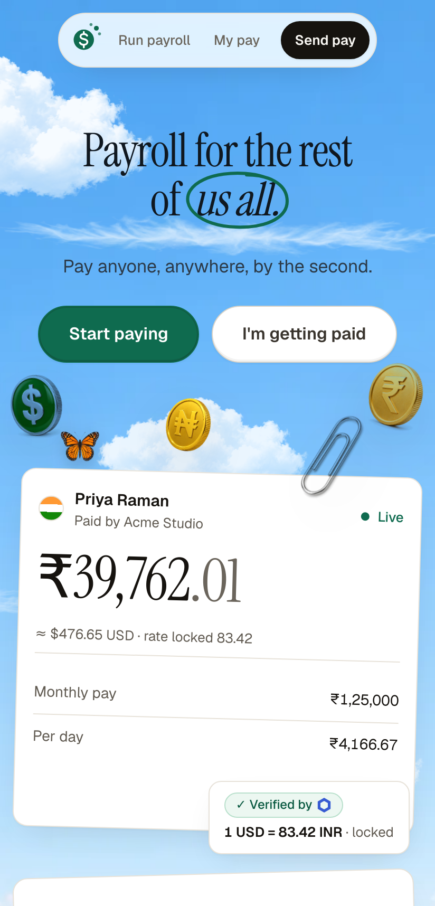
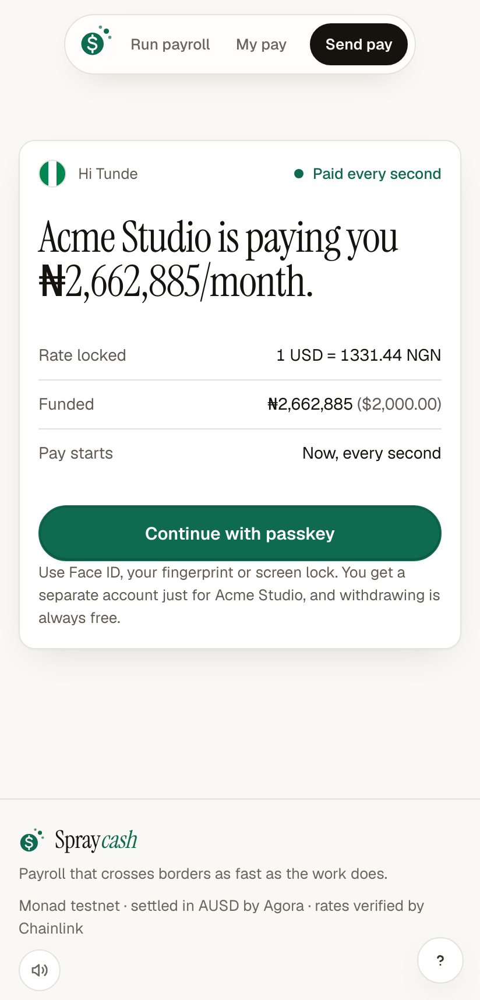
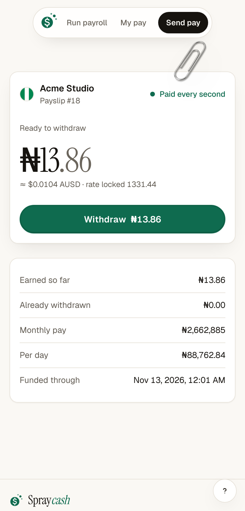
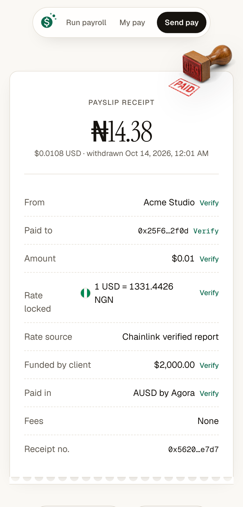

# Spraycash

**Payroll for the rest of us all.** An employer anywhere pays a freelancer in Lagos, Bengaluru, Mexico City or Manila in AUSD, Agora's digital dollar. The freelancer watches the pay go up every second in their own currency, at an exchange rate locked the moment the employer pressed pay, and withdraws whenever they want for free.

Built for Monad Metropolis, Consumer Products & Payments track.

**Live app:** https://spraycash.onrender.com (Monad testnet; a new account starts with $10,000 test AUSD)

## Contents

1. [Screenshots](#screenshots)
2. [How it works](#how-it-works)
3. [Proof on Monad testnet](#proof-on-monad-testnet)
4. [Sponsor tech and where it lives in the code](#sponsor-tech-and-where-it-lives-in-the-code)
5. [Run it yourself](#setup)
6. [Limitations](#limitations)

## Screenshots

**Employer, on a laptop**

<p>


</p>
<p>


</p>
<p>


</p>

**Freelancer, on a phone**

<p>




</p>

## How it works

1. **The employer signs in with a passkey.** A new account gets $10,000 test AUSD straight away, so they can pay someone in the first minute.
2. **They add a freelancer:** name, country (India, Mexico, Philippines or Nigeria), monthly pay and how long to fund it. The rate card shows the pay in the freelancer's currency at the latest Chainlink-verified rate, and holds that quote for 5 seconds.
3. **They press pay.** The AUSD is escrowed in the payroll contract with one signature (an EIP-2612 permit), and the rate is locked into the payslip. If a newer rate lands during confirmation, the contract rejects the payment so the employer can review it. If the rate is older than 10 minutes, paying is blocked.
4. **The freelancer opens the pay link** and signs in with their own passkey. The link carries a one-time key in the URL fragment, which never reaches a server, so nobody who sees the link's transaction can redirect the pay.
5. **The pay streams every second** from the start date, shown in the freelancer's currency with the dollar amount beside it.
6. **The freelancer withdraws** what they've earned at any time. It's free, because the relayer pays the network fee. The receipt links to the withdrawal, the funding transaction and the locked rate report.
7. **The employer can stop pay** at any time. What the freelancer earned stays theirs, and the rest goes back to the employer in the same transaction.

What happens when something goes wrong:

| Case | What the user sees |
|---|---|
| Rate older than 10 minutes | Pay is disabled with "Rate refreshing"; the contract reverts `StaleRate` |
| Rate changed during confirmation | The contract reverts `QuoteChanged`; the app asks the employer to review the new rate |
| Not enough balance | Pay is disabled; the contract reverts `InsufficientBalance` |
| Bad link or wrong key | "This pay link doesn't work" |
| Link already used | "This pay link has already been used" |
| Link expired | The freelancer is told; the employer gets a Refund button |

## Proof on Monad testnet

Contracts (chain 10143):

| Contract | Address |
|---|---|
| SpraycashPayroll | [0x60a281101208e007dbdb0b90dae3f90ef214b962](https://testnet.monadscan.com/address/0x60a281101208e007dbdb0b90dae3f90ef214b962) |
| FxRateReceiver | [0x1331ded23217632b318b828040318ec510857a93](https://testnet.monadscan.com/address/0x1331ded23217632b318b828040318ec510857a93) |
| SpraycashForwarder | [0x29bde2292814d1e7df7ceb4af39f3d8cd3f8bae9](https://testnet.monadscan.com/address/0x29bde2292814d1e7df7ceb4af39f3d8cd3f8bae9) |
| AUSD by Agora | [0xa9012a055bd4e0eDfF8Ce09f960291C09D5322dC](https://testnet.monadscan.com/address/0xa9012a055bd4e0eDfF8Ce09f960291C09D5322dC) |

Payslip #15, recorded end to end on https://spraycash.onrender.com:

| Step | Time (UTC, Oct 13 2026) | Transaction |
|---|---|---|
| Payslip created and funded | 21:47:04 | [0xdc76...f88e](https://testnet.monadscan.com/tx/0xdc76d9590b84108332e0d3eee171ac6fd966381e5cd63f3041a34ead7f7ef88e) |
| Claimed by the freelancer | 21:47:12 | [0x0fcc...5c6b](https://testnet.monadscan.com/tx/0x0fcce87e6dd5cbd669568d0a7347f0af7e4738e3d4134df6b52f7fd250495c6b) |
| Withdrawal (the receipt number) | 21:47:27 | [0x3850...8f02](https://testnet.monadscan.com/tx/0x38501ad28bb454db2721f8676f38a0a61f4de996625c4c732597b80b445c8f02) |
| Pay stopped, rest refunded | 21:47:35 | [0xcd73...5bb2](https://testnet.monadscan.com/tx/0xcd73842d6fa7fa0d228db69a119e256e8bf74612f63897d1b0749f94c6d35bb2) |

Every transaction is sent from the relayer wallet `0xad42...4aC26`, which is how users pay no fees.

## Sponsor tech and where it lives in the code

**Agora AUSD.** AUSD is the only money in the app. Employers fund payroll with one gasless permit signature (`createPayslipWithPermit`), the contract escrows and streams it, and freelancers withdraw AUSD. New accounts are funded from a relayer pool that refills from Agora's testnet faucet. Code: `contracts/contracts/SpraycashPayroll.sol`, `web/src/lib/permit.ts`, `web/src/lib/test-funds.ts`, `web/src/app/api/faucet`.

**Chainlink CRE.** The `cre/spraycash-fx` workflow runs every 60 seconds. It fetches USD rates from Frankfurter (ECB) and open.er-api, takes the median, rejects a pair whose sources differ by more than 1%, and writes a signed report to `FxRateReceiver.onReport`, which only accepts the forwarder and rejects replays. The workflow is unit-tested and compiles to WASM but hasn't been run with the CRE CLI yet, so on testnet the same rates are written by the deployer key for now. Code: `cre/spraycash-fx/`, `contracts/contracts/FxRateReceiver.sol`.

**Mera passkeys: one passkey, many keys.** One passkey gives one WebAuthn PRF secret. HKDF derives a separate account from it for the employer side and for each client a freelancer works for (`client:<employer address>`), so each client's pay stays separate behind one Face ID. The "My pay" page lists them. Code: `web/src/lib/passkey.ts`, `web/src/lib/useAccount.ts`, `web/src/app/me`.

**Envio.** A HyperIndex indexer for payslips, withdrawals, refunds and rate updates feeds the Withdrawals card on each payslip through `/api/history`. It runs locally and isn't hosted yet, so the live site reads history from the contracts instead. Code: `indexer/`, `web/src/app/api/history`.

**Monad.** The payroll, rate receiver and gasless forwarder contracts are on Monad testnet. Fast blocks let the rate be locked and settled before the next report, and let the balance move every block. Code: `contracts/`.

**Kimi K3 via Devin.** The whole UI was designed and built with Kimi K3 via Devin. Code: `web/`.

## Setup

Requirements: Node 22, bun ≥ 1.2.21, the [CRE CLI](https://docs.chain.link/cre/getting-started/cli-installation),
and a funded Monad testnet key.

### 1. Contracts

```bash
cd contracts
npm install
npm test                         # 11 tests: streaming, quote lock, stale, stop/refund, expiry, gasless
export DEPLOYER_PRIVATE_KEY=0x...
export CRE_FORWARDER_ADDRESS=0x...   # CRE forwarder for monad-testnet (simulation uses the MockKeystoneForwarder;
                                     # see the CRE forwarder directory). Unset = deployer, for manual rate pushes.
npm run deploy:monad             # uses Agora AUSD on Monad testnet (checks it has 6 decimals);
                                 # USD_TOKEN=demo deploys the SpraycashUSD stand-in instead
                                 # writes deployments/monadTestnet.json
npm run export-abi               # regenerates web/src/lib/abi.ts
```

Demo tip: the owner can shorten the stale window to show the stale-rate path live:
`SpraycashPayroll.setMaxRateAge(30)` (bounds: 30s–1 day).

### 2. CRE workflow

```bash
cd cre
node set-receiver.mjs            # copies FxRateReceiver address into spraycash-fx/config.staging.json
cp .env.example .env             # CRE_ETH_PRIVATE_KEY = key that broadcasts the simulated write
cd spraycash-fx && bun install && bun test && bunx tsc --noEmit && cd ..
cre workflow simulate spraycash-fx --target staging-settings --broadcast
./run-loop.sh                    # re-runs simulate --broadcast every 60s, logs to cre/logs/simulate.log
```

The workflow compiles to WASM (`bun x cre-compile spraycash-fx/main.ts out.wasm`). The pure aggregation logic
(`fx.ts`) is unit-tested.

### 3. Web app + relayer

```bash
cd web
cp .env.example .env.local       # AUSD + Agora faucet addresses are prefilled; add the other addresses from
                                 # contracts/deployments/monadTestnet.json + RELAYER_PRIVATE_KEY
npm install
npm run dev                      # https required for passkeys anywhere except localhost
```

The relayer (`/api/relay`) only forwards a fixed allowlist of calls (`createPayslip`, `createPayslipWithPermit`, `claim`,
`withdraw`, `stop`, `refundUnclaimed`, plus the local stand-in's `faucet`) to the Spraycash contracts. It verifies the signed ERC-2771 request,
dry-runs the inner call to turn contract errors into plain-language messages, then submits.

Deploy on Render from the Blueprint in `render.yaml`. The only value to set is `RELAYER_PRIVATE_KEY`, the deployer key, which also refreshes FX rates every 4 minutes until CRE is wired.

### 4. Indexer (optional)

```bash
cd indexer && npm install && npx envio codegen && npx envio dev
```

## Testing

| Layer | Command | Status |
|---|---|---|
| Contracts | `cd contracts && npm test` | 12 passing (incl. gasless permit funding) |
| CRE logic | `cd cre/spraycash-fx && bun test` | 5 passing; typechecks; compiles to WASM |
| Web | `cd web && npm run build` | builds and typechecks |
| End to end | `web/e2e/flow.cjs` against a local Hardhat node (chain id via `NEXT_PUBLIC_CHAIN_ID=31337`) | passes |
| Indexer | `cd indexer && npx envio codegen && npx tsc --noEmit` | passes |

The e2e script drives two Chromium contexts, each with a **virtual WebAuthn authenticator with PRF**: employer
sign-up → demo funds → payslip at a locked rate → claim link → freelancer passkey → live ticking → gasless
withdraw → receipt → stop → bad links → expired link refund → stale rate blocks Pay.

Local run:

```bash
cd contracts && npx hardhat node &                       # terminal 1
npx hardhat run scripts/deploy.ts --network localhost
npx hardhat run scripts/push-rate.ts --network localhost # stands in for CRE locally
# web/.env.local: NEXT_PUBLIC_CHAIN_ID=31337, NEXT_PUBLIC_RPC_URL=http://127.0.0.1:8545, addresses, a funded RELAYER_PRIVATE_KEY
cd ../web && npm run dev &
NODE_PATH=$(npm root -g) node e2e/flow.cjs               # screenshots in web/e2e/screenshots
```

## Limitations

- **Testnet AUSD:** payroll uses Agora's test AUSD on Monad testnet, funded from Agora's faucet (10,000 per request, about one a minute). `SpraycashUSD` exists only as a local stand-in. There's no off-ramp to a bank or mobile money yet.
- **NGN is single-source:** the ECB (frankfurter.app) doesn't publish NGN, so NGN comes from open.er-api.com only
  and is labelled "single source" in the UI. INR, MXN and PHP require both sources to agree within 1%.
- **The relayer pays fees** from one funded key. It's allowlisted to Spraycash calls but not rate-limited.
- **The FX rates** on testnet are written by the deployer key from the web server every few minutes, using the same two-source median as the CRE workflow, until the workflow runs on a CRE DON. If it stops, the UI shows the rate age and Pay locks after 10 minutes, by design.
- Names and claim links live in the employer's browser (localStorage). Money, rates and status are always
  read from the contracts.
- Passkeys need WebAuthn PRF (recent Chrome, Safari 18+, iOS 18+, Android 9+). The fallback is a clear error
  message; Privy wasn't integrated.
