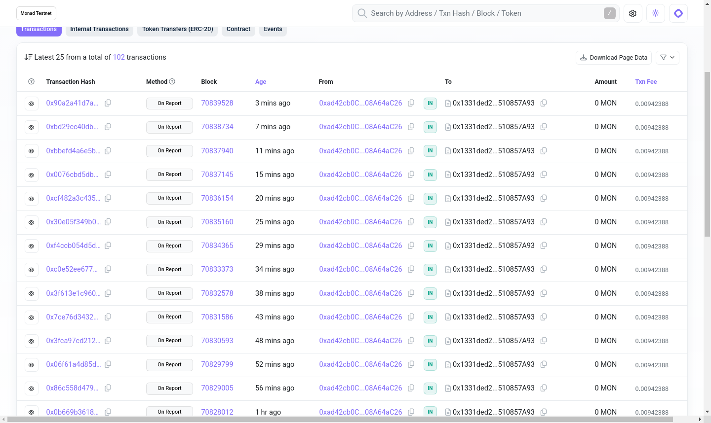
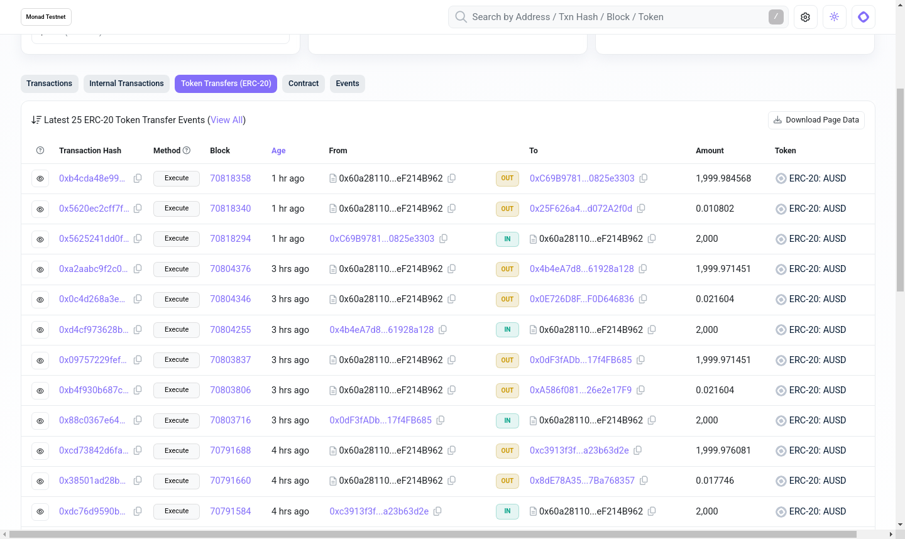
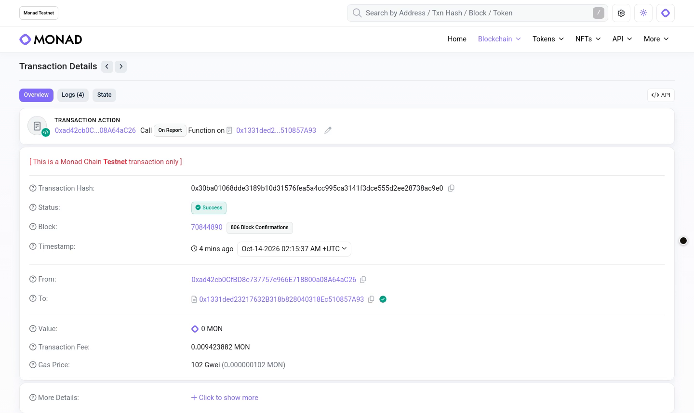
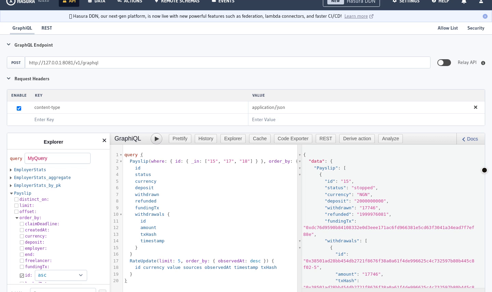

<p align="center">
  
</p>

<p align="center">
  <a href="https://spraycash.onrender.com"></a>
  <a href="https://testnet.monadscan.com/address/0x60a281101208e007dbdb0b90dae3f90ef214b962"></a>
  
  
</p>

#  Spraycash

Spraycash is payroll for the rest of us all. An employer anywhere pays a freelancer in Lagos, Bengaluru, Mexico City or Manila in AUSD, Agora's digital dollar. The freelancer signs in with a passkey, watches the pay go up every second in their own currency at an exchange rate locked the moment the employer pressed pay, and withdraws whenever they want for free.

Built for the people cross-border pay leaves waiting:

- **Freelancers** paid from another country, who wait days for an invoice to clear and lose a cut to the bank in the middle.
- **Small studios and startups** with a few people abroad, who want to pay them without a payroll provider.
- **Anyone paid by the hour or the day**, who would rather see what they've earned so far than wait for the end of the month.

**Try it:** https://spraycash.onrender.com (Monad testnet; a new account starts with $10,000 test AUSD)

## Table of contents

| | Section | What's in it |
|---|---|---|
| 1 | [Why Spraycash](#why-spraycash) | What it does differently |
| 2 | [Pay your first freelancer](#pay-your-first-freelancer) | The live app in four steps |
| 3 | [Sponsor tools, live on testnet](#sponsor-tools-live-on-testnet) | Rate reports, AUSD transfers and Envio's index of Monad testnet |
| 4 | [Built with](#built-with) | Monad, Agora, Chainlink, Mera, Envio, Kimi |
| 5 | [Sponsor tech in detail](#sponsor-tech-in-detail) | How each one is used, its status and its code |
| 6 | [Proof on Monad testnet](#proof-on-monad-testnet) | Contract addresses and a real payslip's transactions |
| 7 | [Everything Spraycash does](#everything-spraycash-does) | Every feature, in one table |
| 8 | [Run from source](#run-from-source) | Contracts, CRE workflow, web app, indexer, tests |
| 9 | [How it works (for developers)](#how-it-works-for-developers) | Contracts, relayer, rates, passkeys, failure cases |
| 10 | [Limitations](#limitations) | What isn't done yet |

## Why Spraycash

- **Paid every second.** Pay streams every second from the start date, so a day's work is in their balance that day.
- **A rate that can't move.** The employer sees the pay in naira, rupees, pesos or Philippine pesos at a verified rate, and that rate is locked into the payslip when they press pay.
- **Free to withdraw.** The relayer pays every network fee, so the freelancer gets everything they earned.
- **A passkey and nothing else.** Fingerprint, face or screen lock. There's no seed phrase, wallet app or extension, and one passkey keeps each client's pay in its own account.
- **Stop pay any time.** What the freelancer earned stays theirs, and the rest goes back to the employer in the same transaction.
- **Ready in a minute.** A new employer account gets $10,000 test AUSD on sign-in, so they can pay someone straight away.

## Pay your first freelancer

1. **Sign in** at https://spraycash.onrender.com with a passkey. Your account is funded with $10,000 test AUSD.
2. **Add a freelancer:** name, country, monthly pay and how long to fund it. The rate card shows their pay in their currency, then press **Pay**.
3. **Send the pay link.** The freelancer opens it, signs in with their own passkey and watches the pay go up every second.
4. **Withdraw or stop.** The freelancer withdraws for free and gets a receipt. You can stop pay at any time.

Press **Show me how** on the payroll, new payslip, payslip or claim page for a guided tour.

## Sponsor tools, live on testnet

<p>


</p>
<p>


</p>

| Sponsor | What's live | Check it |
|---|---|---|
| Chainlink CRE | `FxRateReceiver.onReport` gets a fresh USD/INR, NGN, MXN, PHP report every 4 to 5 minutes. For now the deployer key sends it in the CRE report format; the CRE workflow itself hasn't run through the CRE CLI yet. | [Rate reports](https://testnet.monadscan.com/address/0x1331ded23217632b318b828040318ec510857a93), [latest report](https://testnet.monadscan.com/tx/0x90a2a41d7abee108361ee3e0dd45cfcbc1529939f9b9f7bd88ed2332a9bc53e7#eventlog) |
| Agora AUSD | Every payslip is funded in AUSD into the payroll contract and paid out in AUSD. | [AUSD in and out of payroll](https://testnet.monadscan.com/address/0x60a281101208e007dbdb0b90dae3f90ef214b962#tokentxns) |
| Monad | Payslip #15 created, claimed, withdrawn and stopped, all sent by the relayer so users pay no fees. | [Create](https://testnet.monadscan.com/tx/0xdc76d9590b84108332e0d3eee171ac6fd966381e5cd63f3041a34ead7f7ef88e), [claim](https://testnet.monadscan.com/tx/0x0fcce87e6dd5cbd669568d0a7347f0af7e4738e3d4134df6b52f7fd250495c6b), [withdraw](https://testnet.monadscan.com/tx/0x38501ad28bb454db2721f8676f38a0a61f4de996625c4c732597b80b445c8f02), [stop](https://testnet.monadscan.com/tx/0xcd73842d6fa7fa0d228db69a119e256e8bf74612f63897d1b0749f94c6d35bb2) |
| Mera passkeys | The passkey signs the claim and withdrawal above; the freelancer's per-client account is the `to` of the AUSD payout. | [Withdrawal](https://testnet.monadscan.com/tx/0x38501ad28bb454db2721f8676f38a0a61f4de996625c4c732597b80b445c8f02) |
| Envio HyperIndex | The indexer syncs Monad testnet and returns every payslip, withdrawal and rate update through GraphQL (payslips #15, #17 and #18 in the shot). It runs on our machine against testnet; it isn't hosted yet, so the live site reads history from the contracts. | `indexer/`, `web/src/app/api/history` |

## Built with

<table align="center">
  <tbody>
    <tr>
      <td colspan="6" width="850" align="center"><a href="https://www.monad.xyz/"> <b>Monad</b></a><br /><sub>Payroll, rates and the gasless forwarder, on testnet</sub></td>
    </tr>
    <tr>
      <td colspan="2" width="283" align="center"><a href="https://www.agora.finance/"> <b>Agora AUSD</b></a><br /><sub>The dollar every payslip is paid in</sub></td>
      <td colspan="2" width="283" align="center"><a href="https://chain.link/chainlink-runtime-environment"> <b>Chainlink CRE</b></a><br /><sub>The FX rate workflow</sub></td>
      <td colspan="2" width="283" align="center"><b>Mera passkeys</b><br /><sub>One passkey, a key per client</sub></td>
    </tr>
    <tr>
      <td colspan="3" width="425" align="center"><a href="https://envio.dev/"> <b>Envio HyperIndex</b></a><br /><sub>Payslip and withdrawal history</sub></td>
      <td colspan="3" width="425" align="center"><a href="https://www.kimi.com/"> <b>Kimi K3 via Devin</b></a><br /><sub>Designed and built the whole UI</sub></td>
    </tr>
  </tbody>
</table>

## Sponsor tech in detail

**Agora AUSD.** AUSD is the only money in the app. Employers fund payroll with one gasless permit signature (`createPayslipWithPermit`), the contract escrows and streams it, and freelancers withdraw AUSD. New accounts are funded from a relayer pool that refills from Agora's testnet faucet. Code: `contracts/contracts/SpraycashPayroll.sol`, `web/src/lib/permit.ts`, `web/src/lib/test-funds.ts`, `web/src/app/api/faucet`.

**Chainlink CRE.** The `cre/spraycash-fx` workflow runs every 60 seconds. It fetches USD rates from Frankfurter (ECB) and open.er-api, takes the median, rejects a pair whose sources differ by more than 1%, and writes a signed report to `FxRateReceiver.onReport`, which only accepts the forwarder and rejects replays. Status: the workflow is unit-tested and compiles to WASM but hasn't been run with the CRE CLI yet, so on testnet the same rates are written by the deployer key for now. Code: `cre/spraycash-fx/`, `contracts/contracts/FxRateReceiver.sol`.

**Mera passkeys: one passkey, many keys.** One passkey gives one WebAuthn PRF secret. HKDF derives a separate account from it for the employer side and for each client a freelancer works for (`client:<employer address>`), so each client's pay stays separate behind one Face ID. The "My pay" page lists them. Code: `web/src/lib/passkey.ts`, `web/src/lib/useAccount.ts`, `web/src/app/me`.

**Envio HyperIndex.** An indexer for payslips, withdrawals, refunds and rate updates feeds the Withdrawals card on each payslip through `/api/history`. Status: it runs locally and isn't hosted yet, so the live site reads history from the contracts instead. Code: `indexer/`, `web/src/app/api/history`.

**Monad.** The payroll, rate receiver and gasless forwarder contracts are on Monad testnet. Fast blocks let the rate be locked and settled before the next report, and let the balance move every block. Code: `contracts/`.

**Kimi K3 via Devin.** The whole UI was designed and built with Kimi K3 via Devin. Code: `web/`.

## Proof on Monad testnet

Contracts (chain 10143):

| Contract | Address |
|---|---|
| SpraycashPayroll | [0x60a281101208e007dbdb0b90dae3f90ef214b962](https://testnet.monadscan.com/address/0x60a281101208e007dbdb0b90dae3f90ef214b962) |
| FxRateReceiver | [0x1331ded23217632b318b828040318ec510857a93](https://testnet.monadscan.com/address/0x1331ded23217632b318b828040318ec510857a93) |
| SpraycashForwarder | [0x29bde2292814d1e7df7ceb4af39f3d8cd3f8bae9](https://testnet.monadscan.com/address/0x29bde2292814d1e7df7ceb4af39f3d8cd3f8bae9) |
| AUSD by Agora | [0xa9012a055bd4e0eDfF8Ce09f960291C09D5322dC](https://testnet.monadscan.com/address/0xa9012a055bd4e0eDfF8Ce09f960291C09D5322dC) |

Payslip #15, recorded end to end on https://spraycash.onrender.com:

| Step | Time (UTC, Oct 13 2026) | Transaction |
|---|---|---|
| Payslip created and funded | 21:47:04 | [0xdc76...f88e](https://testnet.monadscan.com/tx/0xdc76d9590b84108332e0d3eee171ac6fd966381e5cd63f3041a34ead7f7ef88e) |
| Claimed by the freelancer | 21:47:12 | [0x0fcc...5c6b](https://testnet.monadscan.com/tx/0x0fcce87e6dd5cbd669568d0a7347f0af7e4738e3d4134df6b52f7fd250495c6b) |
| Withdrawal (the receipt number) | 21:47:27 | [0x3850...8f02](https://testnet.monadscan.com/tx/0x38501ad28bb454db2721f8676f38a0a61f4de996625c4c732597b80b445c8f02) |
| Pay stopped, rest refunded | 21:47:35 | [0xcd73...5bb2](https://testnet.monadscan.com/tx/0xcd73842d6fa7fa0d228db69a119e256e8bf74612f63897d1b0749f94c6d35bb2) |

Every transaction is sent from the relayer wallet `0xad42...4aC26`, which is how users pay no fees.

## Everything Spraycash does

<details>
<summary>Every feature, in one table</summary>

| | Feature | What it does |
|---|---|---|
| F1 | **Passkey sign-in** | Fingerprint, face or screen lock through WebAuthn PRF. No seed phrase, wallet or extension. |
| F2 | **Starting balance** | A new employer account gets $10,000 test AUSD from the relayer pool on first sign-in, with Agora's faucet as the fallback. |
| F3 | **New payslip** | Name, country (India, Mexico, Philippines or Nigeria), monthly pay, start date and how long to fund it. |
| F4 | **Rate card** | The pay in the freelancer's currency at the latest rate, its sources, its age and a link to the rate's transaction. The quote is held for 5 seconds. |
| F5 | **Locked rate** | The rate goes into the payslip when the employer presses pay. If a newer rate lands first, the contract rejects it so the employer can review. |
| F6 | **One-signature funding** | An EIP-2612 permit approves and escrows the AUSD in one gasless signature. |
| F7 | **Pay link** | A claim link with a one-time key in the URL fragment, which never reaches a server, so the pay can't be redirected. |
| F8 | **Streaming pay** | The balance goes up every second from the start date, in the freelancer's currency with the dollar amount beside it. |
| F9 | **Free withdrawals** | The freelancer withdraws what they've earned at any time; the relayer pays the fee. |
| F10 | **Receipts** | Each withdrawal gets a receipt linking the withdrawal, the funding transaction and the locked rate. |
| F11 | **Stop pay** | The employer stops pay at any time; earned pay stays with the freelancer, the rest is refunded in the same transaction. |
| F12 | **Unclaimed refunds** | If a link expires unclaimed, the employer gets a Refund button. |
| F13 | **My pay** | One page listing a freelancer's pay from every client, each in its own passkey-derived account. |
| F14 | **Show me how** | A guided tour on the payroll, new payslip, payslip and claim pages. |
| F15 | **Landing map** | Animated pay routes from New York and London to Lagos, Bengaluru, Mexico City and Manila. |

</details>

## Run from source

Requirements: Node 22, bun ≥ 1.2.21, the [CRE CLI](https://docs.chain.link/cre/getting-started/cli-installation),
and a funded Monad testnet key.

### 1. Contracts

```bash
cd contracts
npm install
npm test                         # 11 tests: streaming, quote lock, stale, stop/refund, expiry, gasless
export DEPLOYER_PRIVATE_KEY=0x...
export CRE_FORWARDER_ADDRESS=0x...   # CRE forwarder for monad-testnet (simulation uses the MockKeystoneForwarder;
                                     # see the CRE forwarder directory). Unset = deployer, for manual rate pushes.
npm run deploy:monad             # uses Agora AUSD on Monad testnet (checks it has 6 decimals);
                                 # USD_TOKEN=demo deploys the SpraycashUSD stand-in instead
                                 # writes deployments/monadTestnet.json
npm run export-abi               # regenerates web/src/lib/abi.ts
```

Demo tip: the owner can shorten the stale window to show the stale-rate path live:
`SpraycashPayroll.setMaxRateAge(30)` (bounds: 30s–1 day).

### 2. CRE workflow

```bash
cd cre
node set-receiver.mjs            # copies FxRateReceiver address into spraycash-fx/config.staging.json
cp .env.example .env             # CRE_ETH_PRIVATE_KEY = key that broadcasts the simulated write
cd spraycash-fx && bun install && bun test && bunx tsc --noEmit && cd ..
cre workflow simulate spraycash-fx --target staging-settings --broadcast
./run-loop.sh                    # re-runs simulate --broadcast every 60s, logs to cre/logs/simulate.log
```

The workflow compiles to WASM (`bun x cre-compile spraycash-fx/main.ts out.wasm`). The pure aggregation logic
(`fx.ts`) is unit-tested.

### 3. Web app + relayer

```bash
cd web
cp .env.example .env.local       # AUSD + Agora faucet addresses are prefilled; add the other addresses from
                                 # contracts/deployments/monadTestnet.json + RELAYER_PRIVATE_KEY
npm install
npm run dev                      # https required for passkeys anywhere except localhost
```

The relayer (`/api/relay`) only forwards a fixed allowlist of calls (`createPayslip`, `createPayslipWithPermit`, `claim`,
`withdraw`, `stop`, `refundUnclaimed`, plus the local stand-in's `faucet`) to the Spraycash contracts. It verifies the signed ERC-2771 request,
dry-runs the inner call to turn contract errors into plain-language messages, then submits.

Deploy on Render from the Blueprint in `render.yaml`. The only value to set is `RELAYER_PRIVATE_KEY`, the deployer key, which also refreshes FX rates every 4 minutes until CRE is wired.

### 4. Indexer (optional)

```bash
cd indexer && npm install && npx envio codegen && npx envio dev
```

### 5. Tests

| Layer | Command | Status |
|---|---|---|
| Contracts | `cd contracts && npm test` | 12 passing (incl. gasless permit funding) |
| CRE logic | `cd cre/spraycash-fx && bun test` | 5 passing; typechecks; compiles to WASM |
| Web | `cd web && npm run build` | builds and typechecks |
| End to end | `web/e2e/flow.cjs` against a local Hardhat node (chain id via `NEXT_PUBLIC_CHAIN_ID=31337`) | passes |
| Indexer | `cd indexer && npx envio codegen && npx tsc --noEmit` | passes |

The e2e script drives two Chromium contexts, each with a **virtual WebAuthn authenticator with PRF**: employer
sign-up → demo funds → payslip at a locked rate → claim link → freelancer passkey → live ticking → gasless
withdraw → receipt → stop → bad links → expired link refund → stale rate blocks Pay.

Local run:

```bash
cd contracts && npx hardhat node &                       # terminal 1
npx hardhat run scripts/deploy.ts --network localhost
npx hardhat run scripts/push-rate.ts --network localhost # stands in for CRE locally
# web/.env.local: NEXT_PUBLIC_CHAIN_ID=31337, NEXT_PUBLIC_RPC_URL=http://127.0.0.1:8545, addresses, a funded RELAYER_PRIVATE_KEY
cd ../web && npm run dev &
NODE_PATH=$(npm root -g) node e2e/flow.cjs               # screenshots in web/e2e/screenshots
```

<details>
<summary><b>How it works</b> (for developers)</summary>

## How it works (for developers)

- **Contracts** (`contracts/`): `SpraycashPayroll` escrows AUSD per payslip, streams it per second between `start` and `end`, and handles claim, withdraw, stop and unclaimed refunds. `FxRateReceiver` stores the latest rate per currency from signed reports. `SpraycashForwarder` is the ERC-2771 forwarder for gasless calls.
- **Relayer** (`web/src/app/api/relay`): forwards a fixed allowlist of calls (`createPayslip`, `createPayslipWithPermit`, `claim`, `withdraw`, `stop`, `refundUnclaimed`), verifies the signed ERC-2771 request, dry-runs it to turn contract errors into plain-language messages, then submits. Relayer writes go through one queue so nonces never collide.
- **Rates**: the contract rejects a payslip if the rate is older than 10 minutes (`StaleRate`) or changed since the quote (`QuoteChanged`). On Render the server checks the rate every 60 seconds and writes a fresh one when it's 4 minutes old.
- **Passkeys** (`web/src/lib/passkey.ts`): one PRF secret per passkey, HKDF-derived accounts per role and per client.
- **History**: `/api/history` reads from the Envio indexer when one is configured, and from contract events otherwise.

What happens when something goes wrong:

| Case | What the user sees |
|---|---|
| Rate older than 10 minutes | Pay is disabled with "Rate refreshing"; the contract reverts `StaleRate` |
| Rate changed during confirmation | The contract reverts `QuoteChanged`; the app asks the employer to review the new rate |
| Not enough balance | Pay is disabled; the contract reverts `InsufficientBalance` |
| Bad link or wrong key | "This pay link doesn't work" |
| Link already used | "This pay link has already been used" |
| Link expired | The freelancer is told; the employer gets a Refund button |

</details>

## Limitations

- **Testnet AUSD:** payroll uses Agora's test AUSD on Monad testnet, funded from Agora's faucet (10,000 per request, about one a minute). `SpraycashUSD` exists only as a local stand-in. There's no off-ramp to a bank or mobile money yet.
- **NGN is single-source:** the ECB (frankfurter.app) doesn't publish NGN, so NGN comes from open.er-api.com only
  and is labelled "single source" in the UI. INR, MXN and PHP require both sources to agree within 1%.
- **The relayer pays fees** from one funded key. It's allowlisted to Spraycash calls but not rate-limited.
- **The FX rates** on testnet are written by the deployer key from the web server every few minutes, using the same two-source median as the CRE workflow, until the workflow runs on a CRE DON. If it stops, the UI shows the rate age and Pay locks after 10 minutes, by design.
- Names and claim links live in the employer's browser (localStorage). Money, rates and status are always
  read from the contracts.
- Passkeys need WebAuthn PRF (recent Chrome, Safari 18+, iOS 18+, Android 9+). The fallback is a clear error
  message; Privy wasn't integrated.
